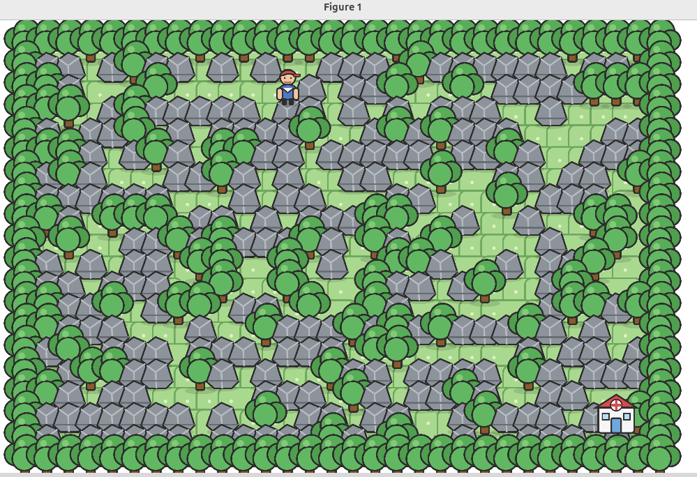
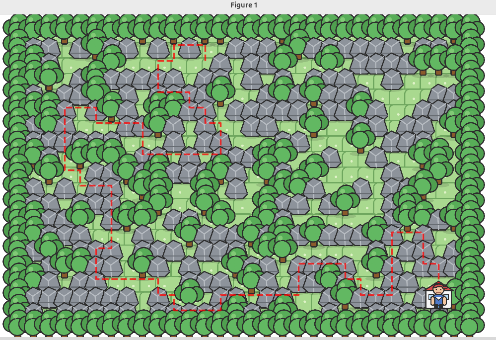
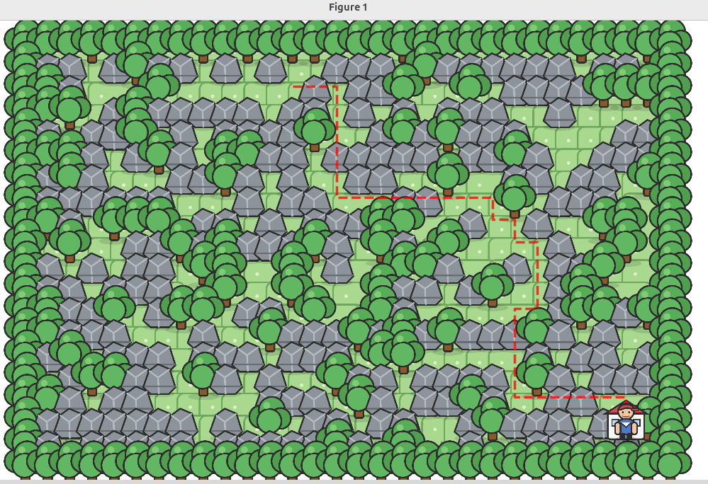

# TD2 - Exercice 4 : Programmation de Dijkstra et A*

Ce dossier contient mon travail réalisé pour l'exercice 4 du TD2 du
cours de AI and Reinforcement Learning.

## Objectif

L'objectif de cet exercice est d'implémenter en Python deux algorithmes
de recherche dans le fichier `search.py` :

-   l'algorithme de **Dijkstra** (Uniform-Cost Search) ;
-   l'algorithme **A\*** avec l'heuristique de Manhattan.

L'environnement Pokémon contient maintenant des terrains avec des coûts
différents : herbe (coût 1), rocher (coût 5) et arbre (bloqué).

## Structure du projet

``` text
exo4/
├── main.py
├── search.py
├── pokemon_game.py
├── requirements.txt
├── pokemon-sprites/
└── images/
```

## Environnement de travail

Le projet est exécuté avec Python 3.12 et un environnement virtuel
Python.

### Création de l'environnement virtuel

``` bash
python3 -m venv .venv
```

### Activation de l'environnement virtuel

``` bash
source .venv/bin/activate
```

### Installation des dépendances

Une fois l'environnement virtuel activé :

``` bash
python -m pip install -r requirements.txt
```

### Exécution du programme

Depuis le dossier `exo4` :

``` bash
python main.py
```

## Changer d'heuristique pour A*

En plus de Manhattan, `search.py` contient d'autres distances de la
famille de Minkowski :

| Fonction | Distance |
|----------|----------|
| `manhattan_distance` | Manhattan (p = 1) |
| `euclidean_distance` | Euclidienne (p = 2) |
| `minkowski_3_distance` | Minkowski (p = 3) |
| `minkowski_4_distance` | Minkowski (p = 4) |
| `chebyshev_distance` | Chebyshev (p → ∞) |

Pour en tester une, il suffit de décommenter la ligne correspondante au
début de `a_star()` :

``` python
heuristic = manhattan_distance
#heuristic = euclidean_distance
#heuristic = minkowski_3_distance
#heuristic = minkowski_4_distance
#heuristic = chebyshev_distance
```

Par défaut, A* utilise `manhattan_distance`.

## Résultats obtenus

Lors de l'exécution avec la carte (`MAP_SEED = 1`), les
résultats obtenus sont les suivants :

``` text
Initial state: (2, 12)
Goal state:    (17, 27)
```

### Chemin aléatoire

Longueur **80**, coût **292**.

### Dijkstra

Longueur **32**, coût **64**, **407** états considérés.

``` text
(2, 12) → (2, 13) → (2, 14) → (3, 14) → (4, 14) → (5, 14) → (6, 14)
→ (7, 14) → (7, 15) → (7, 16) → (7, 17) → (7, 18) → (7, 19) → (7, 20)
→ (7, 21) → (8, 21) → (8, 22) → (9, 22) → (9, 23) → (10, 23) → (11, 23)
→ (12, 23) → (12, 22) → (13, 22) → (14, 22) → (15, 22) → (16, 22)
→ (16, 23) → (16, 24) → (16, 25) → (16, 26) → (16, 27) → (17, 27)
```

### A* (Manhattan)

Longueur **32**, coût **64**, **302** états considérés.
A* trouve exactement le même chemin que Dijkstra, en considérant
105 états de moins.

### Comparaison des heuristiques

| Heuristique | Longueur | Coût | États considérés | Écart avec Dijkstra |
|-------------|---------:|-----:|-----------------:|--------------------:|
| Dijkstra | 32 | 64 | 407 | – |
| `manhattan_distance` | 32 | 64 | **302** | **105** |
| `euclidean_distance` | 32 | 64 | 325 | 82 |
| `minkowski_3_distance` | 32 | 64 | 327 | 80 |
| `minkowski_4_distance` | 32 | 64 | 328 | 79 |
| `chebyshev_distance` | 32 | 64 | 330 | 77 |

Toutes les heuristiques trouvent le coût optimal (64), mais
`manhattan_distance` considère le moins d'états : c'est la meilleure
heuristique pour ce problème.

Avec les autres heuristiques, le chemin diffère d'une seule case
(`(7, 21) → (8, 21) → (9, 21) → (9, 22)` au lieu de
`(7, 21) → (8, 21) → (8, 22) → (9, 22)`), mais il a le même coût.

## Captures d'écran

### Carte générée



### Chemin aléatoire



### Dijkstra



### A* avec `manhattan_distance`


### A* avec `euclidean_distance`


### A* avec `minkowski_3_distance`


### A* avec `minkowski_4_distance`


### A* avec `chebyshev_distance`


